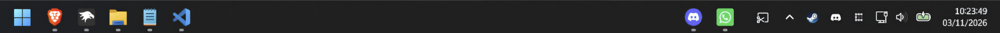

# Taskbar Zones

Organize your **Windows 11 taskbar** into two fixed zones. Keep each app on the left or right, even when you open or close it.

## Features

- Keep apps in **left and right zones**, whether they are running or closed.
- Drag an app across the gap to move it to the other zone.
- Drag icons within a zone to change their order.
- Save app sides and order across Explorer and Windows restarts.
- Adjust spacing and the size of right-side icons.
- Support compatible secondary taskbars on multiple monitors.
- Keep your Windows pinned apps unchanged.

## Installation

1. Install [Windhawk](https://windhawk.net/) if you do not already have it.
2. Search for **Taskbar Zones** in Windhawk when it is available in the catalog.
3. Click **Install**.

## How to use

1. Set your Windows 11 taskbar alignment to **Left**.
2. Drag an app icon across the empty space to choose its zone.
3. Drag icons within the same zone to reorder them.
4. Change spacing and icon size in the mod settings if needed.

Your chosen app positions are saved automatically.

## Compatibility and limitations

- Designed for the **Windows 11** taskbar.
- Secondary taskbars show only the app buttons that Windows provides on those monitors.
- Do not enable other mods that move or resize the same taskbar buttons at the same time.
- If there is not enough room for both zones, the mod may use the native Windows layout to prevent overlap.
- Windows updates may change internal taskbar behavior and affect compatibility.

## Troubleshooting

If the layout does not work as expected, check that the taskbar is left-aligned and disable other taskbar positioning mods. Then disable and enable Taskbar Zones in Windhawk.

If you find a bug, [open an issue](https://github.com/luizbizzio/taskbar-zones/issues). Include your Windows version, what happened, and the steps to reproduce it. Mention whether you use multiple monitors or other taskbar mods.

## Author and license

Modified and maintained by **Luiz Bizzio**. Based on [Taskbar Split by Arkadiusz (Artllex)](https://github.com/Artllex/taskbar-split).

Licensed under **GPL-3.0**; see [LICENSE](LICENSE). Other code credits and copyright notices are included in the mod source file.
